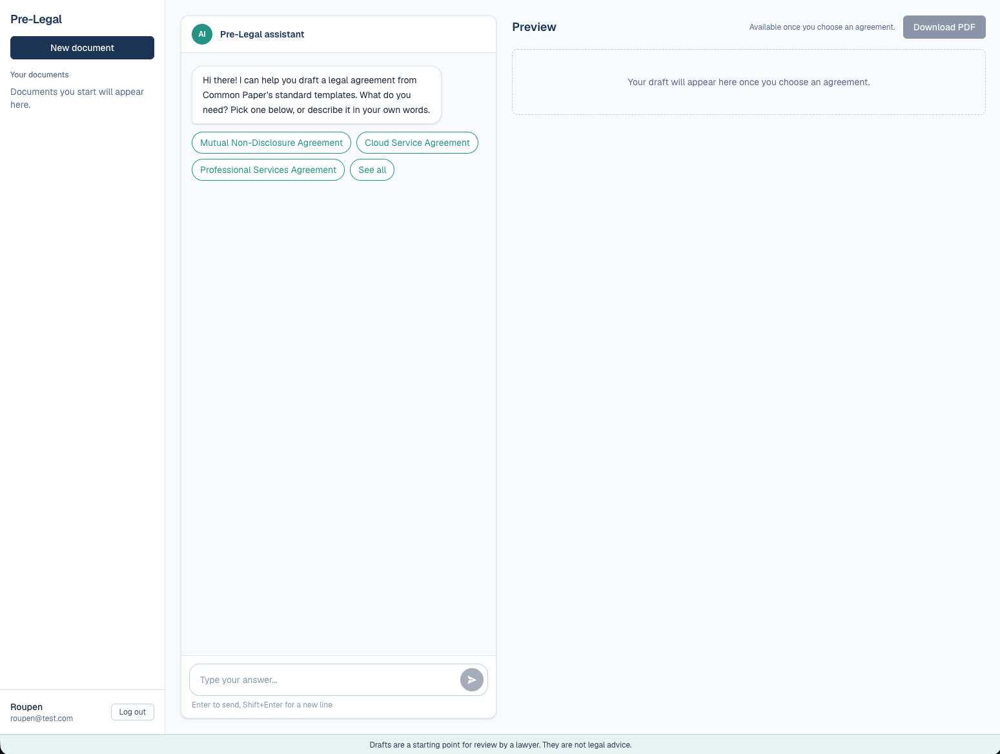
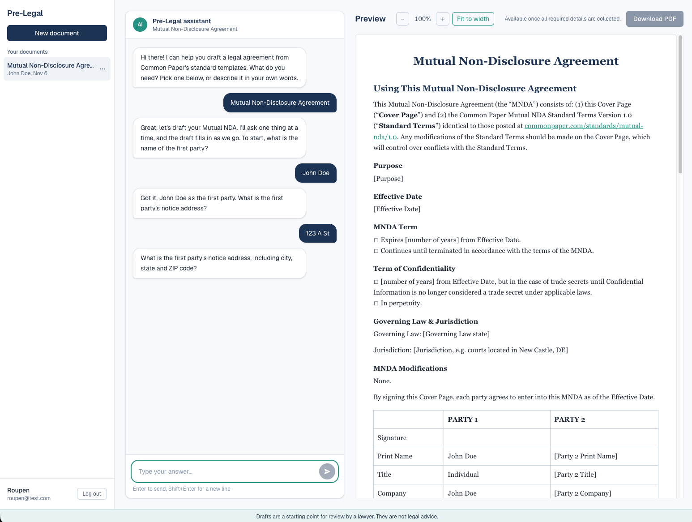
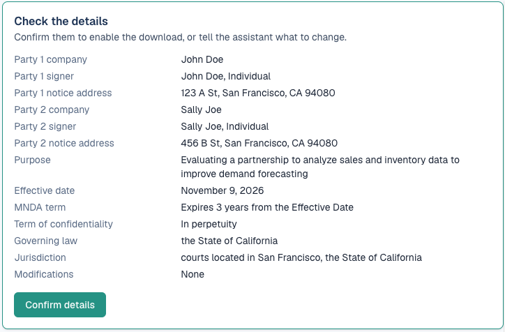

# Pre-Legal

Pre-Legal drafts common legal agreements through a chat. You describe what you need, an AI asks for the details, and the agreement fills in beside the conversation. When you've checked the details, you download it as a PDF.

**Drafts are a starting point for review by a lawyer, not legal advice.**

It covers 11 agreements, based on [Common Paper](https://commonpaper.com)'s standard templates: Mutual NDA, Cloud Service, Service Level, Data Processing, Professional Services, Software License, Pilot, Design Partner, Partnership, Business Associate and AI Addendum.

## Screenshots



*Start by picking an agreement or describing what you need.*



*A street on its own gets a follow-up question, and the draft fills in beside the chat.*



*Before downloading, you confirm a summary that code builds from the collected details.*

## How to run it

You need [Docker Desktop](https://www.docker.com/products/docker-desktop/), running, and an [OpenRouter](https://openrouter.ai) API key. The scripts are written for a Mac.

1. Create a file called `.env` in the project root with this line, with no spaces or quotes:

   ```
   OPENROUTER_API_KEY=your-key
   ```

2. Start the app, then open http://localhost:8000 and sign up:

   ```
   scripts/start.sh
   ```

3. Stop it with `scripts/stop.sh`.

Starting the app wipes its database, so accounts and drafts don't survive a restart.

### Development

Run these in two terminals, then open http://localhost:3000. The development tools need [uv](https://docs.astral.sh/uv/) and Node.js.

```
cd backend && CORS_ORIGINS=http://localhost:3000 uv run uvicorn app.main:app --reload
cd frontend && npm run dev
```

Run the tests with `cd backend && uv run pytest` and `cd frontend && npm test`. They use a mocked AI, so they cost nothing.

## Tech stack

- **Frontend:** Next.js and React, built as static files, with Tailwind CSS
- **Backend:** Python, FastAPI, managed with uv
- **Database:** SQLite
- **AI:** `gpt-oss-120b` on Cerebras, through OpenRouter and LiteLLM, with structured outputs
- **Tests:** pytest, Vitest and Testing Library
- **Deployment:** one Docker container

## How this was built

I'm learning to become an AI engineer, and I built Pre-Legal with [Claude Code](https://claude.com/claude-code), which wrote most of the code. My role was deciding what to build, making the design choices, and testing the result.

- **Jira tickets:** each piece of work started as a ticket saying what it should do, why, and what "done" means.
- **feature-dev:** feature tickets went through Claude Code's feature-dev workflow: explore the code, ask questions, compare designs, build, review. I chose the design before any code was written.
- **PR review:** every ticket ended in a pull request. Code-review agents checked for bugs, needless complexity and project conventions, and I decided what to fix and when to merge.
- **My own test plans:** automated tests can't show whether a chat feels right, so I tested in a browser and against the real AI. For example, my browser test of the Mutual NDA found the AI asking for an address again after I had given it, which the automated tests had missed.

[How it works](docs/how-it-works.md) explains the whole app in plain English.

## Key design decisions

- **Code builds the summary, not the AI.** The summary you confirm is built directly from the collected details, so it always matches what will be printed.
- **The app ends the interview.** The AI sometimes combined the final two requests into one message, and rewording its instructions didn't stop that. So the server tracks the interview's stage and asks those questions itself.
- **Code checks what it reliably can.** It firmly rejects impossible dates, out-of-range numbers and badly formed U.S. states or ZIP codes. Whether an answer is vague is left to the AI, because code can't tell a first name from someone's only name.
- **One catalog drives every agreement.** Each agreement's questions, defaults and definition of a complete answer are data in `templates/catalog.json`, so most agreements share one engine. The NDA keeps its own hand-tuned questions and fields.
- **The AI doesn't repeat routine terms.** When it had to copy long default wording back each turn, it altered it. It now returns only the terms the user asks to change.
- **The server remembers nothing between AI calls.** Each chat message sends the conversation and the details so far, and the AI returns one structured answer: the details, an acknowledgement and the next question.

## Known limitations

Pre-Legal isn't ready for real users yet:

- **The database resets on restart.** All accounts and drafts are lost.
- **No password reset.** A forgotten password means losing access to the account.
- **No login rate limiting.** Nothing limits how many passwords someone can try.
- **Two tabs can overwrite each other.** With one draft open in two tabs, the last save wins and the other tab's newer answers are lost.
- **No HTTPS setup.** The session cookie must be marked Secure before this is deployed.
- **The AI can make mistakes.** It occasionally misses a vague answer, or asks a question it didn't need to. Check the summary, and have a lawyer review the draft.

## License

The code is under the [MIT License](LICENSE). The agreement templates are from Common Paper under CC BY 4.0: see [`templates/LICENSE.md`](templates/LICENSE.md).
